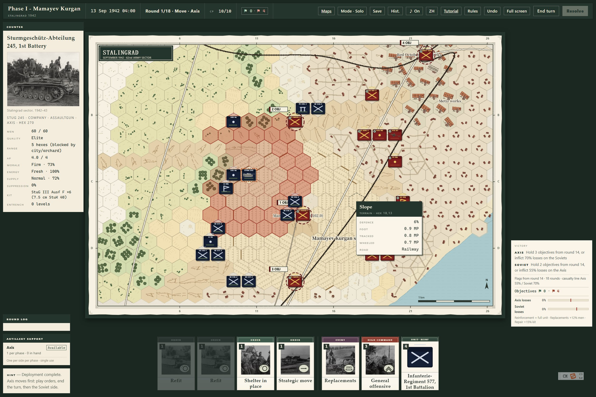
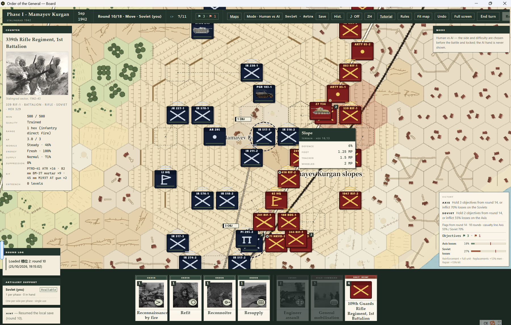
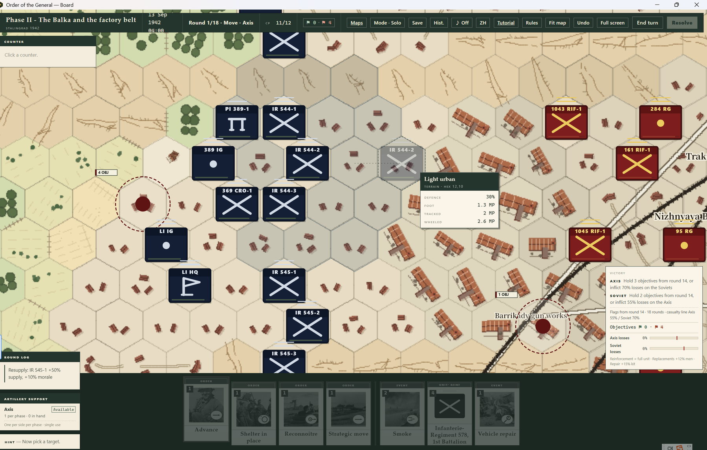
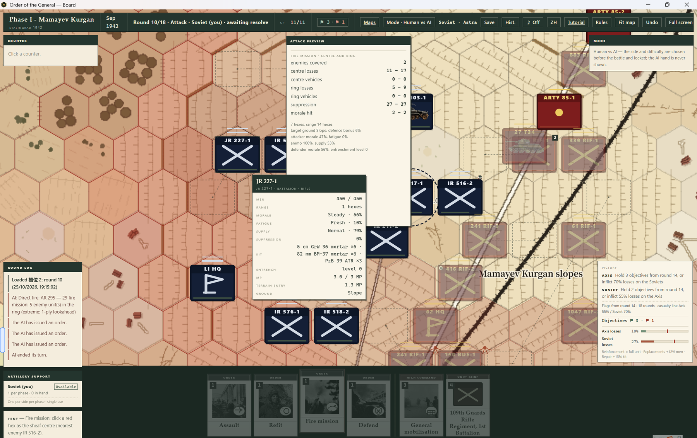
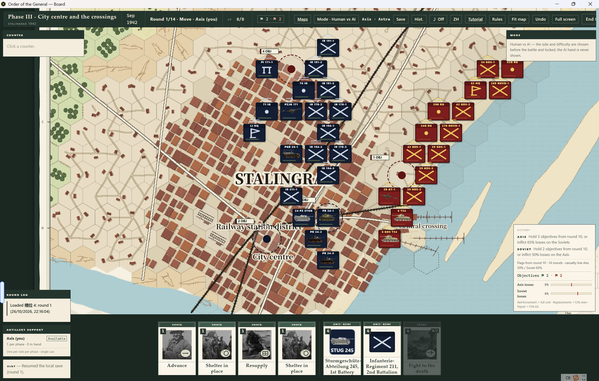
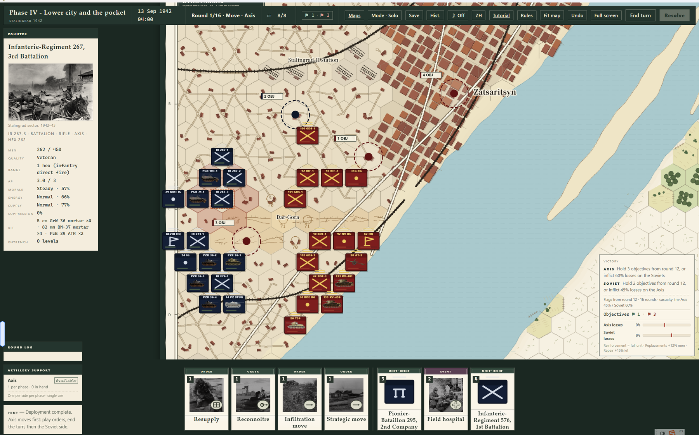

# Order of the General — Stalingrad 1942
## Free Playtest Build

A **card-driven hex-and-counter wargame** set in Stalingrad, 1942.

Companies and battalions, 216 metres per hex, about one hour per round. You command through a hand of orders and a limited pool of command points — not through a perfect plan.

Free playtest for Windows · Chinese / English UI · Source not included.

## A card-driven wargame, computed by the machine

This is a wargame first: hexes, zones of control, line of fire, stacking, supply, morale, fieldworks and combined arms.

It is card-driven second: your orders are a hand of cards, not a menu. You may know what you want to do, but this hour of the battle only lets you do so much.

The computer does the work that would stop a tabletop game:

- line of fire, range and terrain
- stacking and overstacking
- supply traces and encirclement
- casualties, vehicles, equipment and morale
- artillery sheaves, suppression and fieldworks
- the opponent's legal actions and plans

The result is faster, smoother and more consistent than resolving the same detail by hand — and it lets the game keep the depth of a tabletop wargame without stopping to look up tables.

## A complete AI, not a scripted opponent

The AI plays the same game you do:

- same decks, same cards, same command points and same combat rules
- it does not read your hand or your hidden orders
- it builds legal actions and evaluates objectives, terrain, stacking, supply, ZOC, fieldworks and threat
- it prepares artillery, suppresses positions, uses observed fire, combines arms before an assault, and focuses fire on guns and broken remnants

Four difficulty levels change planning depth and command budget:

- **Easy** — simpler scoring and fewer CP
- **Normal** — full rules scoring
- **Hard** — wider candidates and one-ply lookahead
- **Extreme** — widest candidates and lookahead; artillery, suppression and combined-arms preparation before the assault

It defends, counter-attacks and punishes overextension without cheating.

## Card-driven command

Each side has three decks: movement, attack and special.

- Every phase deals **4 normal cards + 3 special cards**
- Normal cards are re-dealt when the phase changes
- Unplayed specials carry into the attack phase
- The special deck guarantees at least one reinforcement card
- Shuffles are random every new game; a hand with no playable normal card is redrawn

### Ground has memory: ZOC

- Entering or leaving an enemy ZOC ends the move
- A unit cannot step straight from one enemy ZOC hex into another
- Infantry and engineers can use **Infiltration Move**: spend all remaining action points, move at 0.8× MP, ignore enemy ZOC

### Artillery is preparation

- A fire mission covers a chosen centre and its six neighbours
- The full legal range is shown; clicking outside it cancels the card
- Shellfire suppresses, damages and can collapse fieldworks
- Each covered hex has a chance to lose one fieldworks level
- Firing costs supply

## Four ways to play

- **Solo** — one player controls both sides
- **Vs AI** — choose Axis or Soviet and one of four difficulties; the AI hand stays hidden
- **Hot-seat** — two players share one machine; a hand-over screen hides orders
- **LAN PVP** — create or join a local-network room; server-authoritative, each player sees only their own hand

LAN PVP is local-network play, not internet matchmaking. No account or online service is required.

## What is in the playtest

- Four Stalingrad boards
- Company/battalion scale, 216 m hexes, about one hour per round
- Card-driven command with three decks
- ZOC, infiltration, artillery fire missions, fieldworks and encirclement
- Complete AI with four difficulty levels
- Solo, hot-seat and LAN PVP
- Save/load, in-game rules and tutorial
- Chinese and English UI

## Download

Get the latest playtest build from **[GitHub Releases](https://github.com/zhaooahz11111/order-of-the-general/releases)**:

- `Order.of.the.General.Setup.1.1.0.exe` — Windows installer
- `Order.of.the.General.1.1.0.exe` — portable build

Windows 10/11 x64. Unsigned build; if SmartScreen appears, choose **More info → Run anyway**. Check `SHA256SUMS.txt`.

English-only edition: **[Release v1.1.0-en](https://github.com/zhaooahz11111/order-of-the-general/releases/tag/v1.1.0-en)**.

> This is a free playtest build. Rules, card counts, balance and content may still change. Source code is not included.

---

# 将官序列：斯大林格勒 1942
## 免费体验版

一款以斯大林格勒 1942 为背景的**卡驱六角格兵棋**免费体验版。

连/营级单位，216 米一格，一回合约一小时战斗。你通过一手命令牌和有限的指挥点来指挥，而不是靠一张完美计划表。

Windows · 中文 / English 界面 · 免费体验 · 不含源码。

## 卡驱兵棋，交给计算机结算

首先它是兵棋：六角格、ZOC、视线、堆叠、补给、士气、工事、合同作战。

其次它是卡驱：你的命令是一手牌，不是菜单。你知道自己想做什么，但这一小时只允许你做这么多。

计算机负责桌面上最耗时的部分：

- 视线、射程与地形
- 堆叠与超堆叠
- 补给线与被包围
- 伤亡、载具、装备与士气
- 炮兵弹着、压制与工事
- 对手的合法行动与计划

因此它比手工查表结算更快、更顺、更一致，也能保留桌游兵棋的细节深度，而不用每次停下来翻表。

## 完善而强大的 AI

AI 和你玩同一套游戏：

- 同样的牌库、卡牌、指挥点和战斗规则
- 不偷看你的手牌和隐藏命令
- 自己生成合法行动，评估目标、地形、堆叠、补给、ZOC、工事和威胁
- 会炮火准备、压制阵地、观察射击、在突击前组织合同作战，并集中火力打炮兵和残部

四档难度同时改变规划深度和指挥点预算：

- **简单**：评分更简单、CP 更少
- **普通**：完整规则评分
- **困难**：更宽候选 + 一层预判
- **极难**：最宽候选与预判；突击前先炮击、压制、组织合同作战

它会防守、反击、惩罚冒进，而且不作弊。

## 卡驱指挥

每方三套牌库：移动、攻击、特殊。

- 每阶段 **4 张普通牌 + 3 张特殊牌**
- 阶段切换时重发普通牌
- 未打出的特殊牌保留到攻击阶段
- 特殊牌库保证至少一张增援卡
- 每局随机洗牌；四张普通牌都不可用时重抽

### 地面有记忆：ZOC

- 进入或离开敌方 ZOC 会结束移动
- 不能从一个敌方 ZOC 格直接走进另一个
- 步兵/工兵可用**渗透移动**：花光剩余行动值，以 0.8 倍移动力移动，无视敌方 ZOC

### 炮兵是准备，不是按钮

- 火力任务覆盖选定中心格及周围六格
- 显示完整合法范围；点范围外取消用牌
- 炮击压制、杀伤，并可能摧毁工事
- 每个被覆盖格有概率削掉一级工事
- 开火消耗补给

## 四种游玩方式

- **单人推演**：一人操作双方
- **人机对战**：选德军或苏军与四档 AI 难度；AI 手牌不可见
- **本机热座**：两人共用一台机器，交接时遮罩隐藏命令
- **局域网对战**：创建/加入本地网络房间；服务器权威，各自只看到自己的手牌

局域网对战是本地联机，不是互联网匹配；不需要账号或在线服务。

## 体验版内容

- 四张斯大林格勒地图
- 连/营级规模，216 米一格，一回合约一小时
- 三牌库卡驱指挥
- ZOC、渗透移动、炮兵火力任务、工事、包围断补给
- 完善 AI，四档难度
- 单人、热座、局域网对战
- 存档、游戏内规则与教程
- 中文 / English 界面

## 下载

到 **[GitHub Releases](https://github.com/zhaooahz11111/order-of-the-general/releases)** 下载：

- `Order.of.the.General.Setup.1.1.0.exe` — Windows 安装程序
- `Order.of.the.General.1.1.0.exe` — 免安装便携版

Windows 10/11 x64。未签名程序可能触发 SmartScreen，点“更多信息 → 仍要运行”。校验值见 `SHA256SUMS.txt`。

纯英文版：**[Release v1.1.0-en](https://github.com/zhaooahz11111/order-of-the-general/releases/tag/v1.1.0-en)**。

> 本作是免费体验版，规则、卡牌数量、平衡和内容仍可能调整；不含源码。
