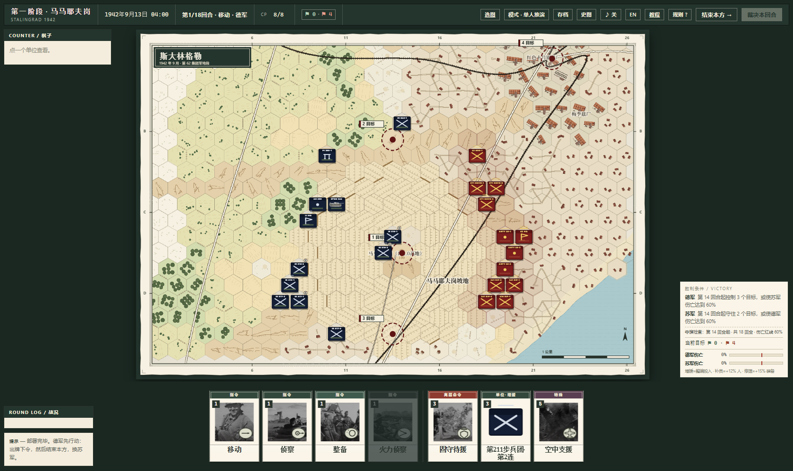

# Order of the General — Stalingrad 1942

**将官序列：斯大林格勒 1942**  
A company/battalion hex-and-counter wargame of the Stalingrad battle.  
一款连/营级六角格兵棋，背景为 1942 年斯大林格勒。

**Version 1.1.0 · Windows · Freeware · Source not included**

[Download the latest release](https://github.com/zhaooahz11111/order-of-the-general/releases/latest)

## 中文

### 这是什么

- 四张斯大林格勒战场：马马耶夫岗、巴尔卡与工厂区、市中心与渡口、下城
- 216 米一格，连/营级单位，一回合代表约一小时战斗
- 三套牌库：移动牌库、攻击牌库、特殊牌库
- 每阶段 4 张普通牌 + 3 张特殊牌；特殊牌跨阶段保留
- 六角格 ZOC、渗透移动、炮兵火力任务、工事、包围断补给
- 单机人机对战 + 双人同屏
- 中文 / English 界面

### 下载

到 **[Releases](https://github.com/zhaooahz11111/order-of-the-general/releases)** 下载：

- `Order.of.the.General.Setup.1.1.0.exe` — Windows 安装程序
- `Order.of.the.General.1.1.0.exe` — 免安装便携版

Windows 10/11 x64。未签名程序首次运行可能触发 SmartScreen：点“更多信息”→“仍要运行”；校验值见 `SHA256SUMS.txt`。

### 1.1.0 要点

- 炮击结算后不再保留炮击小标志
- 空投：2 CP，补给补满，士气 +20
- 防空火力、为了帝国、为了祖国母亲：1 CP
- 三牌库结构与特殊牌跨阶段保留
- 新增/调整：渗透移动、ZOC 链式移动限制、包围断补给、炮兵工事毁伤

### 操作

- 左键己方单位：攻击范围
- 右键己方单位：移动范围
- 点卡牌，再点目标；`结束本方` 交接阶段
- 完整规则：游戏内“规则”按钮；教程：游戏内“教程”按钮

### 说明

本作是免费发布的可执行文件，**不包含源代码**。允许原样转发安装包/便携版用于非商业目的；不得反编译、修改后冒充官方版本或商业售卖。第三方历史照片的作者与许可见 `CREDITS.md`。

---

## English

### What it is

- Four Stalingrad boards: Mamayev Kurgan, the balka/factory district, the city centre and ferries, the lower town
- 216 m per hex; company/battalion counters; one round is about one hour of combat
- Three decks: movement, attack and special
- Each phase: 4 normal cards + 3 specials; unplayed specials carry into the attack phase
- Hex ZOC, infiltration movement, artillery fire missions, fieldworks, encirclement supply cut
- Single-player vs AI + two-player hotseat
- Chinese / English UI

### Download

Get the latest build from **[Releases](https://github.com/zhaooahz11111/order-of-the-general/releases)**:

- `Order.of.the.General.Setup.1.1.0.exe` — Windows installer
- `Order.of.the.General.1.1.0.exe` — portable build

Windows 10/11 x64. The build is unsigned; if SmartScreen appears, choose **More info → Run anyway**. Check `SHA256SUMS.txt`.

### 1.1.0 highlights

- Shellfire impact badges are cleared after resolution
- Airdrop: 2 CP, full supply, +20 morale
- Flak umbrella, For the Empire and For the Motherland: 1 CP
- Three-deck structure with special-card carry-over
- Infiltration move, ZOC-chaining restriction, encirclement supply cut, artillery fieldworks damage

### Controls

- Left-click a friendly unit: attack range
- Right-click a friendly unit: movement range
- Pick a card, then a target; **End side** hands over the phase
- Full rules: in-game **Rules**; tutorial: in-game **Tutorial**

### Note

This is a freeware binary release. **Source code is not included.** You may redistribute the unmodified installer/portable package for non-commercial purposes. Do not reverse-engineer, modify and pass off as official, or sell it. Third-party historical photographs are credited in `CREDITS.md`.

## System requirements

- Windows 10/11 x64
- 4 GB RAM
- 500 MB free disk space
- No network required for single-player

## Credits / licence

See [CREDITS.md](CREDITS.md) and [LICENSE.txt](LICENSE.txt).  
Historical photographs remain the property of their respective archives/authors and are used under the licences listed there.
